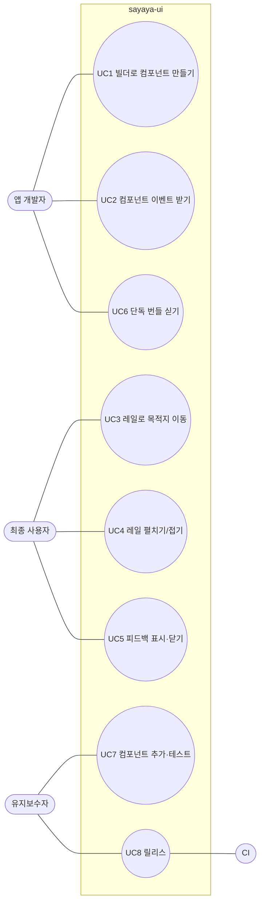

# 2. 유스케이스 모델

## 유스케이스 다이어그램

Mermaid 에 유스케이스 표기가 없어 `flowchart` 로 그렸습니다(둥근 노드 = 액터, 타원 = 유스케이스).

## 간략형

| ID | 이름 | 주 액터 | 요약 |
|---|---|---|---|
| UC1 | 빌더로 컴포넌트 만들기 | 앱 개발자 | 정적 팩토리(예: `button()`, `navigationRail()`, `datePicker()`)로 시작해 속성을 체이닝하고 `element()` 로 DOM 요소를 얻어 붙인다 |
| UC2 | 컴포넌트 이벤트 받기 | 앱 개발자 | `onActivated`, `onExpandedChanged`, `onClosed` 등으로 콜백을 등록한다 |
| UC3 | 레일로 목적지 이동 | 최종 사용자 | 레일 항목을 누르거나 ↑/↓·Home/End 로 이동해 목적지를 활성화한다 |
| UC4 | 레일 펼치기/접기 | 최종 사용자 | 메뉴 버튼으로 레일을 펼치거나 접는다. 전환 모션이 재생된다 |
| UC5 | 피드백 표시·닫기 | 최종 사용자 | 툴팁·스낵바·토스트를 보고 액션·닫기·시간 초과로 닫는다 |
| UC6 | 단독 번들 싣기 | 앱 개발자 | Material Web 을 따로 싣는 앱이 feedback/navigation ESM 번들만 싣는다 |
| UC7 | 컴포넌트 추가·테스트 | 유지보수자 | 빌더·JS·테스트를 추가하고 브라우저 테스트로 검증한다 |
| UC8 | 릴리스 | 유지보수자 | 버전을 올리고 태그를 push 해 산출물을 배포한다 |

## UC3 레일로 목적지 이동 (정식형)

- **범위**: md-navigation-rail(직접 구현) / **수준**: 사용자 목표
- **사전 조건**: 앱이 `navigationRail()` 에 `railItem()` 을 둘 이상 넣고 `onActivated` 를 등록했다.
- **성공 보장**: 선택한 항목 하나만 활성(`active`)이고, 앱이 그 인덱스를 받았다. 링크 항목이면 `aria-current="page"` 가 붙는다.

**주 성공 시나리오**
1. 사용자가 목적지 항목을 고른다.
2. 시스템이 그 항목을 활성으로 표시하고 나머지를 비활성으로 바꾼다.
3. 시스템이 앱에 활성 인덱스(링크면 href 포함)를 알린다.
4. modal 로 펼친 레일이면 시스템이 레일을 접는다.

**확장**
- 1a. 사용자가 비활성(disabled) 항목을 고른다: 시스템은 아무것도 바꾸지 않는다.
- 1b. 사용자가 키보드 ↑/↓·Home/End 를 누른다: 시스템은 포커스만 옮기고(disabled 건너뜀, 끝에서 감기지 않음) 활성화하지 않는다.
- 1c. 링크 항목을 수식 키(Cmd/Ctrl/Shift/Alt)나 가운데 버튼으로 연다: 시스템은 활성화하지 않고 브라우저 기본 동작(새 탭)에 맡긴다.
- 3a. 앱이 링크 이동을 가로챈다(`interceptLinks`): 시스템은 브라우저 기본 이동을 막고 href 를 앱 라우터로 넘긴다.
- 1d. footer 슬롯의 항목을 고른다: 목적지가 아니므로 활성 인덱스를 바꾸지 않는다.

## UC8 릴리스 (정식형)

- **사전 조건**: main 의 전체 테스트가 통과했다.
- **성공 보장**: 같은 버전의 jar 가 GitHub Packages 에 있고 Maven Central 에 업로드됐으며, GitHub Release(draft 아님, Latest)에 jar 3개와 JS 번들 3개, 각 `.sha256` 이 첨부됐다.

**주 성공 시나리오**
1. 유지보수자가 `build.gradle.kts` 의 version 과 README 좌표를 올리고 main 에 push 한다.
2. CI 가 테스트를 실행해 성공한다.
3. 유지보수자가 같은 버전의 annotated 태그 `v<version>` 를 push 한다.
4. CI(Publish)가 빌드·서명하고 GitHub Packages 와 Central Portal 에 올린다.
5. CI 가 단일·feedback·navigation 번들과 체크섬을 만들어 Release 에 첨부한다.
6. 유지보수자가 Release·Packages·jar 내용(javap)·번들(grep)을 확인한다.

**확장**
- 4a. Central Portal 업로드가 `USER_MANAGED` 다: 유지보수자가 Portal 에서 직접 Publish 해야 repo1 에 공개된다.
- 4b. 같은 버전을 다시 배포한다: GitHub Packages 의 해당 버전을 먼저 지워야 한다(남아 있으면 409). Central 은 덮어쓸 수 없다.
