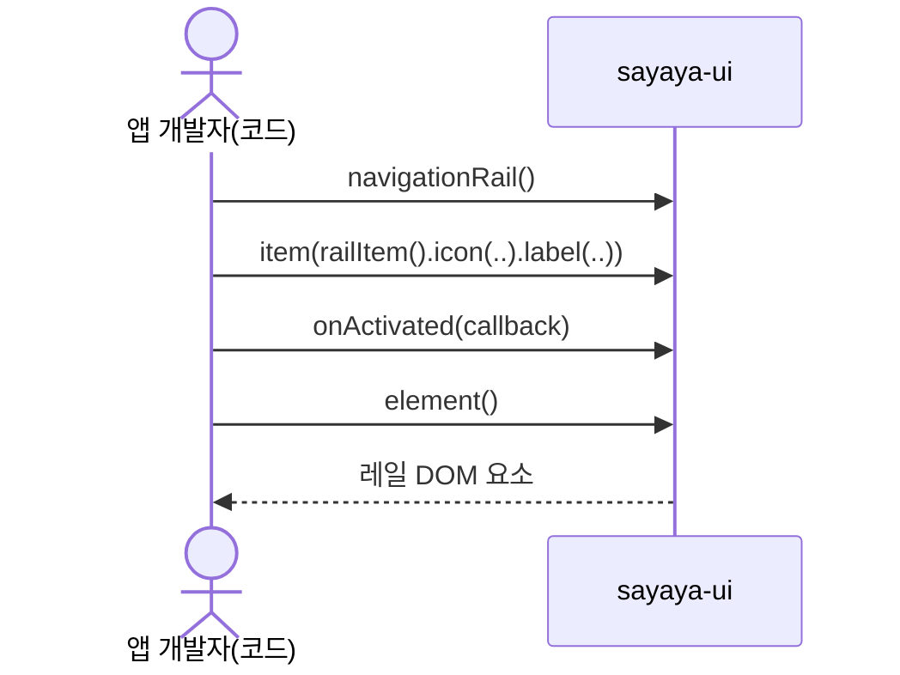
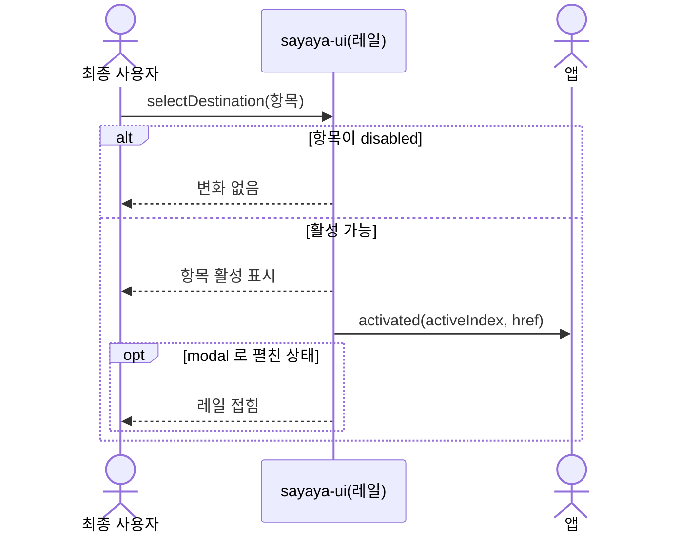
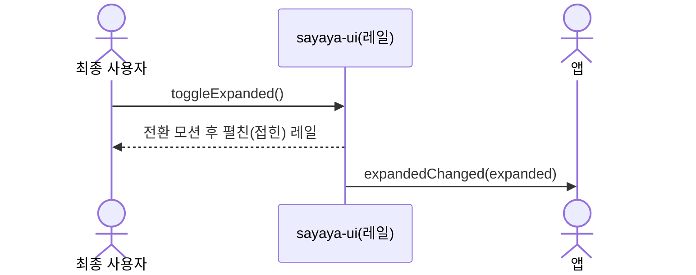

# 3. 시스템 시퀀스 다이어그램(SSD)

SSD 는 시스템을 블랙박스로 두고 액터와 주고받는 **시스템 오퍼레이션**만 보입니다. 내부 객체는 05 설계 시퀀스에서 다룹니다.

## SSD-UC1·UC2 빌더로 레일을 만들고 이벤트 받기



| 시스템 오퍼레이션 | 사후 조건 |
|---|---|
| `navigationRail()` | `md-navigation-rail` 요소가 만들어졌다 |
| `item(...)` | 항목 요소가 레일의 자식이 됐다 |
| `onActivated(callback)` | 활성화 시 callback 이 인덱스를 받도록 등록됐다 |
| `element()` | 앱이 요소를 문서에 붙일 수 있다 |

## SSD-UC3 목적지 이동



## SSD-UC4 레일 펼치기/접기



## SSD-UC8 릴리스

```mermaid
sequenceDiagram
  actor M as 유지보수자
  participant S as 배포 파이프라인
  M->>S: pushMain(version)
  S-->>M: 테스트 결과
  M->>S: pushTag(v&lt;version&gt;)
  S-->>M: jar(GitHub Packages, Central Portal), Release 첨부물
```
