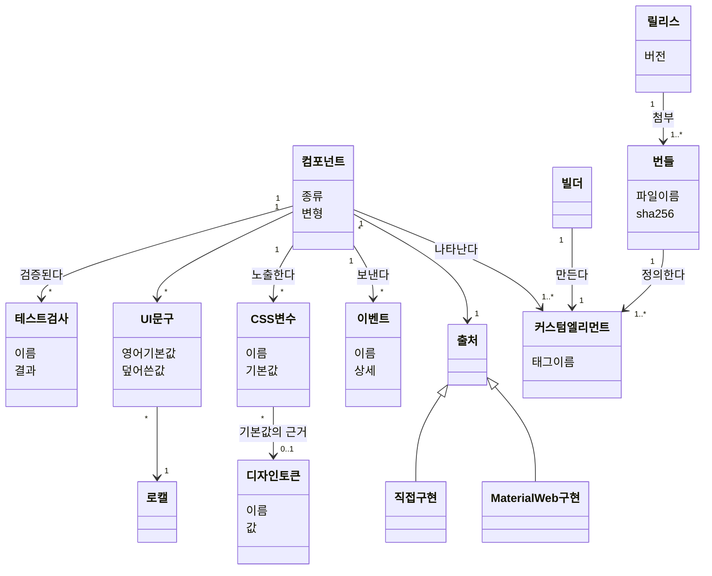

# 4. 도메인 모델

개념 클래스와 연관만 보입니다(오퍼레이션 없음). 이름은 문제 영역의 말이며 코드 클래스와 1:1 이 아닙니다.

| 개념 | 설명 |
|---|---|
| 출처 | Material Web 구현(감쌈) 또는 직접 구현(Lit 엘리먼트·elemento 빌더). 공식 구현이 나오면 직접 구현을 교체한다 |
| 디자인토큰 | `@material/web` 의 `md-comp-*` 토큰. 수치의 우선 출처 |
| CSS변수 | `--md-<컴포넌트>-<부위>` 형식. 소비자가 치수·모양을 바꾸는 공식 경로 |
| 번들 | `labs.bundle.js`(GWT 앱용), 단일 IIFE, 단독 feedback·navigation ESM |
| 테스트검사 | 브라우저 콘솔 로그 `<접두어>: <이름> - PASS/Assertion failed!` 한 줄 |
