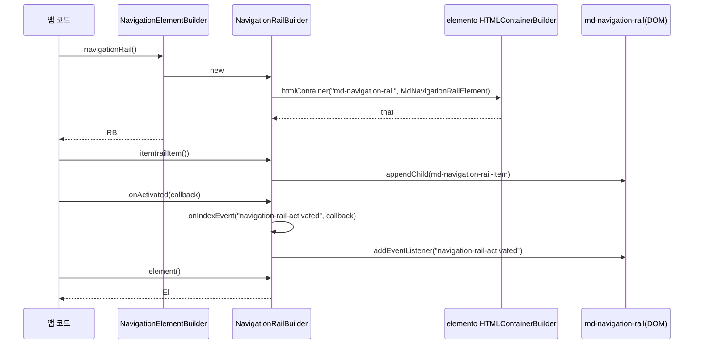
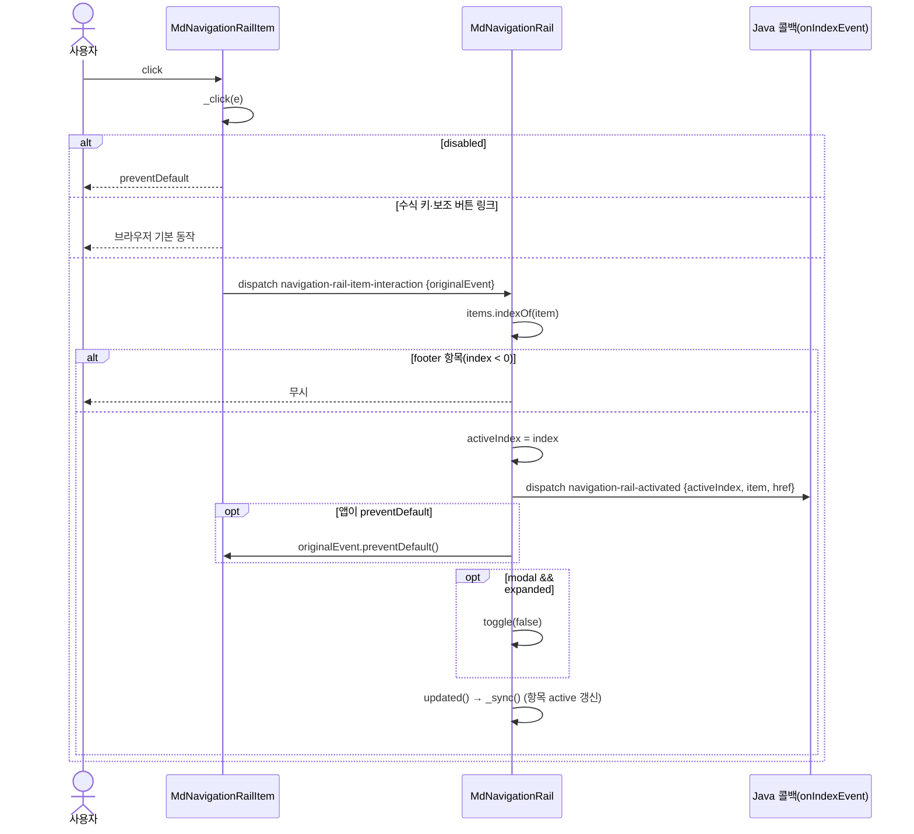
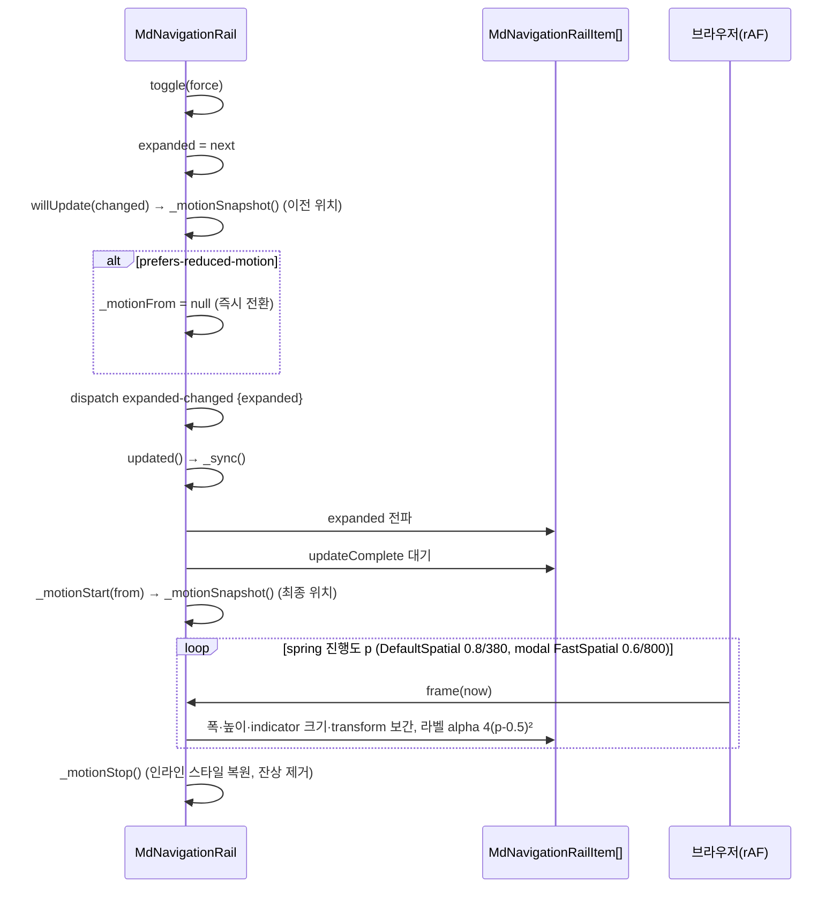
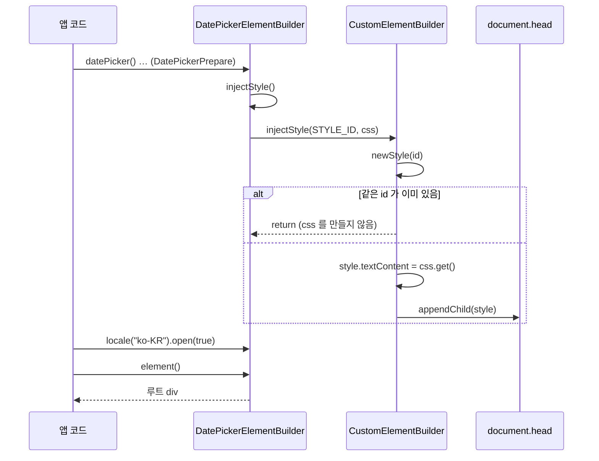
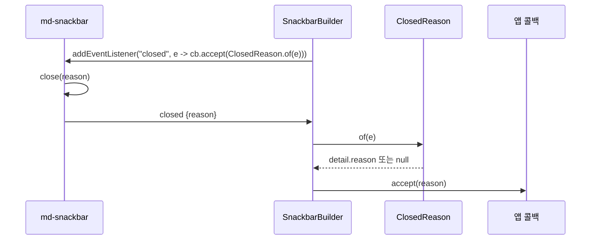
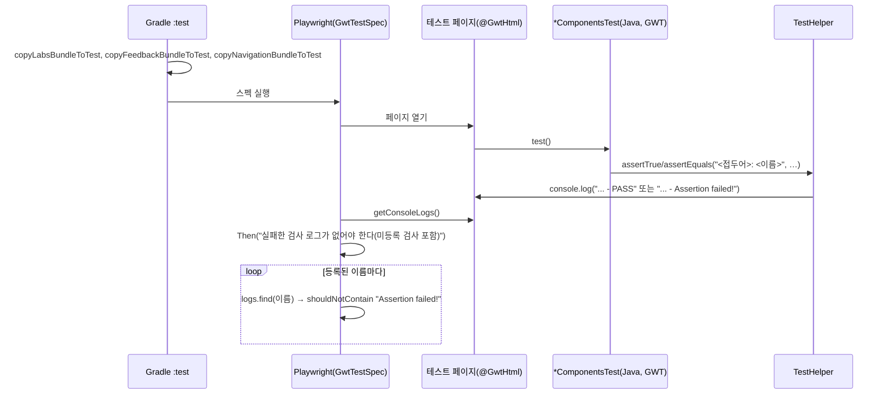

# 5. 설계 시퀀스 다이어그램

각 다이어그램은 시스템 오퍼레이션 하나를 객체 수준에서 실현합니다. 메시지 이름은 소스의 메서드·이벤트 이름 그대로입니다.

## DS-1 `navigationRail()` … `onActivated(callback)` (UC1·UC2)

## DS-2 항목 선택 (UC3)

## DS-3 `toggle()` 펼침/접힘과 전환 모션 (UC4)

## DS-4 직접 구현 빌더 생성과 스타일 1회 주입 (UC1, 예: `datePicker()`)

## DS-5 닫힘 사유 전달 (UC5, sheet·snackbar·toast)

## DS-6 브라우저 테스트 실행 (UC7)

