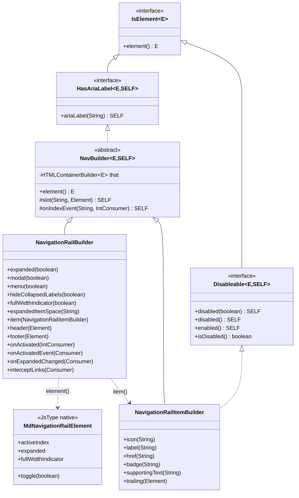
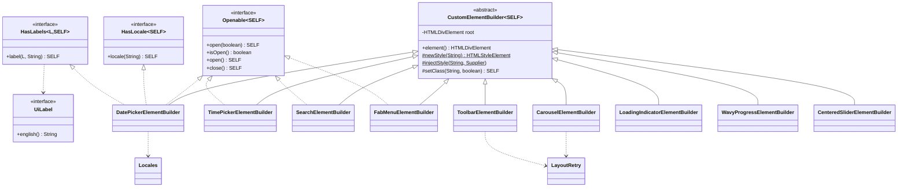

# 6. 설계 클래스 다이어그램

빌더는 세 가지 형태입니다. 모두 elemento 의 `IsElement<E>`(`element()`)와 자기 타입 `SELF`(`that()`)로 체이닝합니다.

| 형태 | 대표 | DOM 타입 | 루트 |
|---|---|---|---|
| A. Material Web 감싸기 | `ButtonElementBuilder` 와 변형별 `FilledButtonElementBuilder` 등 | `dom/` 의 `@JsType(isNative)` 바인딩(`MdButtonElement`) | `htmlContainer("md-filled-button", …)` |
| B. 직접 구현 Lit 엘리먼트 감싸기 | `NavigationElementBuilder.NavigationRailBuilder`, `FeedbackElementBuilder.SnackbarBuilder`, `SideSheetElementBuilder` | `dom/MdNavigationElement` 등 | `md-navigation-rail` 등(labs 번들의 `sayaya-*.js`) |
| C. 순수 elemento 빌더 | `CustomElementBuilder` 하위 9개 | 없음(바인딩 미사용, NFR-8) | `div` |

## A·B 형태

- `NavBuilder` 와 같은 모양의 공개 추상 베이스가 `FeedbackElementBuilder.FbBuilder`, `GbElementBuilder.GbBuilder` 로 셋 있습니다. 공개 타입이라 통합은 메이저 버전으로 미뤘습니다(NFR-1).
- 이벤트 바인딩은 `addEventListener(<이벤트 이름>)` 로 하며, 이름은 JS 엘리먼트와 일치해야 합니다(`navigation-rail-activated`, `expanded-changed`, `closed`, `opened`, `action`).

## C 형태(순수 elemento 빌더)

- `SliderElementBuilder` 는 Material Web 슬라이더를 감싸는 A 형태지만, 같은 패키지라 `CustomElementBuilder.injectStyle(...)` 를 정적으로 호출합니다.
- `ClosedReason`, `LayoutRetry` 는 패키지 범위 헬퍼(공개 API 아님)입니다.

## 적용한 패턴

| 패턴 | 어디 | 이유 |
|---|---|---|
| Builder(+ 자기 타입 제네릭) | 모든 빌더 | 체이닝으로 DOM 구성, 하위 타입에서도 반환형 유지 |
| Creator·정적 팩토리 | `button()`, `navigationRail()`, `datePicker()` … | 생성 진입점 하나, 변형별 구현 숨김(`ButtonPrepareElementBuilder`) |
| Template Method | `CustomElementBuilder` | 루트·스타일 주입·클래스 토글을 베이스가 맡고 하위는 내용만 |
| Pure Fabrication | `ClosedReason`, `LayoutRetry`, `Locales` | 도메인 개념이 아닌 반복 책임을 따로 둠 |
| Protected Variations / Adapter | 빌더 API ↔ 내부 태그 | 공식 `md-gb-*` 로 교체해도 빌더·이벤트 이름 유지 |
| Indirection(CSS 변수) | `--md-*` fallback 체인 | 소비자 조정과 토큰 기본값 분리 |
