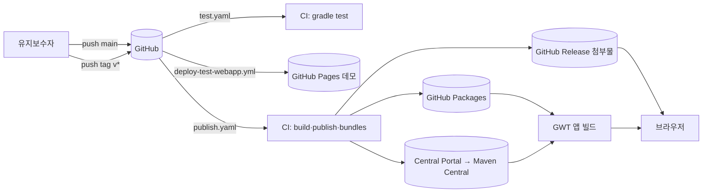

# 7. 패키지·컴포넌트·배포

## 패키지

```mermaid
flowchart TB
  subgraph java[Java: dev.sayaya.ui]
    elements[elements\n빌더·헬퍼]
    interfaces[elements.interfaces\n빌더 특성]
    dom[dom\nJsType 바인딩]
  end
  subgraph js[JS: src/main/webapp/labs-bundle/src]
    index[index.js\nlabs 번들 진입점]
    nav[sayaya-navigation.js\napp bar·rail]
    navbar[sayaya-navbar.js\nnavigation bar]
    fb[sayaya-feedback.js\ntooltip·snackbar·toast]
    bg[sayaya-button-group.js]
    sheet[sayaya-sheet.js\nside·bottom sheet]
    stand[sayaya-navigation-standalone.js]
  end
  mw[(@material/web)]
  elemento[(elemento / elemental2)]
  elements --> interfaces
  elements --> dom
  elements --> elemento
  dom -. 같은 태그 이름 .-> js
  index --> nav & navbar & fb & bg & sheet
  index --> mw
  stand --> nav & navbar
```

- `elements` → `dom` 의존은 A·B 형태 빌더만 갖습니다. C 형태(직접 구현 elemento 빌더)는 `dom` 을 쓰지 않습니다.
- Java 와 JS 의 결합점은 **태그 이름·속성 이름·이벤트 이름**뿐입니다. 이 이름을 바꾸면 양쪽을 함께 바꾸고 테스트로 확인합니다.

## 컴포넌트(빌드 산출물)

| 산출물 | 만드는 태스크 | 내용 | 소비자 |
|---|---|---|---|
| `dev.sayaya:ui` jar | `gradle build` / `publish` | Java 소스·클래스·GWT 모듈 `dev/sayaya/Ui.gwt.xml`(JS 없음) | GWT 앱 |
| `labs.bundle.js` | `buildLabsBundle`(rollup.config.js) | labs + 직접 구현 엘리먼트, ES module | GWT 앱(all.js 뒤에 로드), 테스트 페이지 |
| `sayaya-ui-<v>.js` | `buildStandaloneBundle` | `@material/web/all.js` + labs, IIFE | CDN 없이 쓰는 앱 |
| `sayaya-ui-feedback-<v>.js` | `buildFeedbackBundle`(rollup.esm-bundle.js) | `md-tooltip`, `md-snackbar`, `md-toast` + lit | Material Web 을 따로 싣는 앱 |
| `sayaya-ui-navigation-<v>.js` | `buildNavigationBundle`(rollup.esm-bundle.js) | `md-top-app-bar`, `md-navigation-rail(-item)`, `md-navigation-bar`, `md-navigation-tab` + lit | 같음(`md-icon-button` 은 앱이 제공) |

## 배포



- Central Portal 업로드는 `USER_MANAGED` 라서 Portal 에서 직접 Publish 해야 repo1 에 공개됩니다.
- `package-lock.json` 은 커밋하지 않으므로 CI 는 `package.json` 범위(`@material/web ^2.5.0`) 안의 최신을 받습니다. 2.5.1 정식 출시가 그대로 들어옵니다.

## 품질 속성과 전술

| 품질 속성 | 전술 | 구현 |
|---|---|---|
| 공존성(NFR-3) | 등록 전 확인 | `if (!customElements.get(name))`, `labs.bundle.js` 의 rollup intro/outro 가드 |
| 수명주기(NFR-4) | 자원 해제·재획득 | `connectedCallback`/`disconnectedCallback` 에서 리스너·타이머 정리(app bar, button group, toast) |
| 검증 가능성(NFR-6) | 전체 실패 로그 검사, 입력 선언 | 모든 Kotest 스펙의 미등록 검사 포함 실패 검사, `:test` 입력에 테스트 번들 |
| 수정 용이성 | 중간 계층 | 빌더 API ↔ 태그(어댑터), CSS 변수 fallback 체인 |
