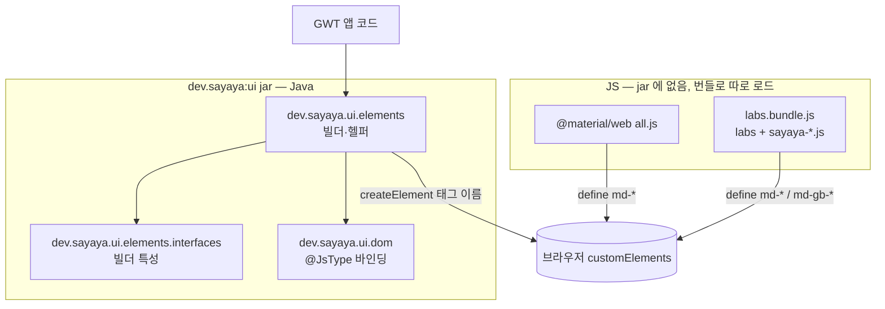
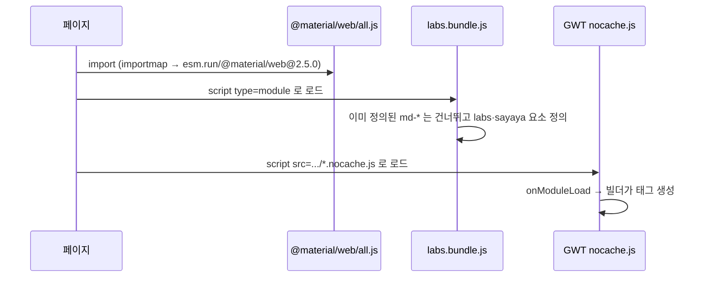

# 1. 아키텍처

## 한눈에 보기

sayaya-ui 는 **Java 빌더 계층**과 **JS 커스텀 엘리먼트 계층** 두 층으로 되어 있습니다. 두 층은 태그 이름·속성 이름·이벤트 이름으로만 연결됩니다.



- jar 에는 JS 가 없습니다. 앱은 Material Web 과 labs 번들(또는 Release 첨부 번들)을 따로 실어야 합니다.
- 빌더는 태그를 만들 뿐이고, 그 태그를 그리는 것은 브라우저에 등록된 커스텀 엘리먼트입니다.

## Java 계층

GWT 모듈은 `src/main/java/dev/sayaya/Ui.gwt.xml`(`dev.sayaya.Ui`) 하나입니다. `com.google.gwt.user.User` 와 `org.jboss.elemento.Core` 를 상속하고 `ui` 패키지를 소스로 씁니다.

| 패키지 | 역할 |
|---|---|
| `dev.sayaya.ui.elements` | 공개 빌더(`ButtonElementBuilder`, `NavigationElementBuilder`, `DatePickerElementBuilder` …)와 패키지 내부 헬퍼(`ClosedReason`, `LayoutRetry`, `Locales`) |
| `dev.sayaya.ui.elements.interfaces` | 빌더 특성: `Disableable`, `HasAriaLabel`, `Openable`, `HasLocale`, `HasLabels`/`UiLabel`, 슬롯·이벤트 인터페이스 등 |
| `dev.sayaya.ui.dom` | JS 요소의 속성·메서드를 Java 에서 쓰기 위한 `@JsType(isNative = true)` 클래스(`MdButtonElement`, `MdNavigationElement` …) |

빌더는 세 형태입니다.

| 형태 | 루트 요소 | dom 바인딩 | 예 |
|---|---|---|---|
| A. Material Web 감싸기 | `md-*` (Material Web·labs) | 씀 | `button()`, `checkbox()`, `card()`, gb 빌더 |
| B. 직접 구현 Lit 엘리먼트 감싸기 | `md-*` (`labs-bundle/src/sayaya-*.js`) | 씀 | `navigationRail()`, `snackbar()`, `sideSheet()` |
| C. 순수 elemento 빌더 | `div` | 쓰지 않음 | `datePicker()`, `search()`, `carousel()`, `toolbar()`, `fabMenu()` (`CustomElementBuilder` 하위) |

모든 빌더는 elemento 의 `IsElement<E>`(`element()`)와 자기 타입 `SELF`(`that()`)로 체이닝합니다. 자세한 클래스 구조는 [design/06](../design/06-design-classes.md) 을 보세요.

## JS 계층 (`src/main/webapp/labs-bundle`)

| 파일 | 정의하는 요소 |
|---|---|
| `src/main/webapp/labs-bundle/src/index.js` | labs 번들 진입점. labs card·badge, `md-gb-*` 16종, navigation drawer 를 import 하고 아래 sayaya 파일을 모두 import |
| `src/main/webapp/labs-bundle/src/sayaya-navigation.js` | `md-top-app-bar`, `md-navigation-rail`, `md-navigation-rail-item` |
| `src/main/webapp/labs-bundle/src/sayaya-navbar.js` | `md-navigation-bar`, `md-navigation-tab` (M3 flexible nav bar) |
| `src/main/webapp/labs-bundle/src/sayaya-feedback.js` | `md-tooltip`, `md-snackbar`, `md-toast` |
| `src/main/webapp/labs-bundle/src/sayaya-button-group.js` | `md-button-group` |
| `src/main/webapp/labs-bundle/src/sayaya-sheet.js` | `md-side-sheet`, `md-bottom-sheet` |
| `src/main/webapp/labs-bundle/src/sayaya-navigation-standalone.js` | 단독 navigation 번들 진입점(navigation·navbar 만 import) |

모든 정의는 이미 등록된 이름이면 건너뜁니다(`if (!customElements.get(name))`). labs 번들 전체는 rollup `intro`/`outro` 로 번들 실행 중에만 `customElements.define` 을 같은 방식으로 감쌉니다.

## Java ↔ JS 결합점

결합은 문자열 이름 세 가지뿐입니다. 한쪽을 바꾸면 반드시 다른 쪽과 테스트를 함께 바꿉니다.

| 종류 | 예 (Java 빌더 → JS) |
|---|---|
| 태그 이름 | `NavigationRailBuilder` → `md-navigation-rail` |
| 속성 | `fullWidthIndicator(boolean)` → `fullWidthIndicator` 프로퍼티 / `full-width-indicator` 속성 |
| 이벤트 | `onActivated` → `navigation-rail-activated`, `onExpandedChanged` → `expanded-changed`, `onClosed` → `closed`(`detail.reason`) |

## 런타임 로드 순서

테스트 페이지(`src/test/webapp/navigation.html` 등)와 앱이 따라야 하는 순서입니다.



- labs 번들은 all.js **뒤에** 실어야 합니다. `remove-elevation` 플러그인이 labs 쪽 `md-elevation` 정의를 지우고 all.js 의 것을 쓰기 때문입니다(gb 컴포넌트는 예외).
- Material Web 을 따로 번들하는 앱은 labs 번들 대신 단독 feedback·navigation ESM 번들을 씁니다([02-build.md](02-build.md)).

## 소스 트리

```
sayaya-ui/
├── build.gradle.kts            # 플러그인·의존성·npm Exec 태스크·GWT 설정
├── .github/workflows/          # test.yaml, deploy-test-webapp.yml, publish.yaml, code-review.yaml
├── docs/design/                # UP 설계 문서
├── docs/development/           # 이 문서
├── src/main/java/dev/sayaya/
│   ├── Ui.gwt.xml
│   └── ui/{elements,elements/interfaces,dom}/
├── src/main/webapp/labs-bundle/
│   ├── package.json            # @material/web ^2.5.0, rollup ^4
│   ├── rollup.config.js        # → ../labs.bundle.js
│   ├── rollup.standalone.config.js, standalone.mjs   # → dist/sayaya-ui.js
│   ├── rollup.esm-bundle.js    # 단독 ESM 번들 팩토리
│   ├── rollup.feedback.config.js, rollup.navigation.config.js
│   └── src/                    # index.js, sayaya-*.js
└── src/test/
    ├── java/dev/sayaya/*ElementTest.gwt.xml        # 컴포넌트별 GWT 테스트 모듈
    ├── java/dev/sayaya/ui/*ElementTest.java        # 진입점(EntryPoint)
    ├── java/dev/sayaya/ui/<컴포넌트>/*ComponentsTest.java  # 검사·데모
    ├── java/dev/sayaya/ui/TestHelper.java
    ├── kotlin/dev/sayaya/ui/test/*ElementTest.kt   # Kotest(Playwright) 스펙
    └── webapp/*.html                               # 테스트·데모 페이지
```

## 앞으로 바뀔 부분

Material Web 공식 `md-gb-nav-rail`, `md-gb-nav-bar`, `md-gb-snackbar`, `md-gb-button-group`, `md-gb-toolbar`, `md-gb-app-bar` 가 정식 출시되면 B 형태 직접 구현을 교체합니다. **빌더 API 와 이벤트 이름은 유지**하고 내부 태그만 바꿉니다(어댑터). 그때까지 직접 구현 JS 의 큰 구조 변경은 하지 않습니다.
