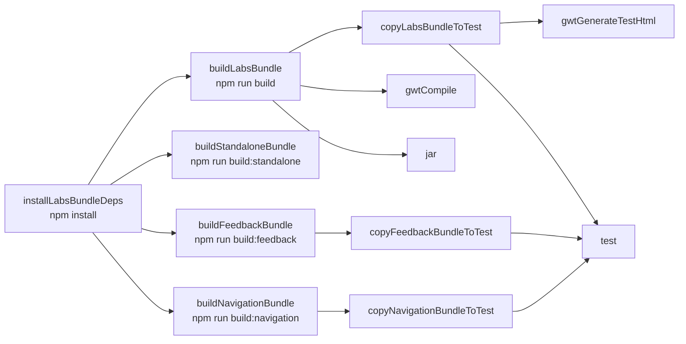

# 2. 빌드

## 필수 도구

| 도구 | 버전·출처 |
|---|---|
| JDK | CI 는 temurin 24(`test.yaml`, `deploy-test-webapp.yml`), 21(`publish.yaml`) |
| Gradle | 래퍼(`gradlew`)는 저장소에 추적되지 않습니다. CI 는 `gradle/actions/setup-gradle` 이 준비한 `gradle` 을 씁니다 |
| Node.js·npm | labs 번들 빌드용(`npm` 이 PATH 에 있어야 함) |

## 선언된 의존성 (`build.gradle.kts`)

| 항목 | 버전 |
|---|---|
| Kotlin JVM 플러그인 | 2.4.21 |
| `dev.sayaya.gwt` 플러그인 | 2.4.0 (GWT `gwtVersion = "2.13.1"`, `strict = true`) |
| `com.vanniktech.maven.publish` | 0.37.0 |
| `org.jboss.elemento:elemento-core` | 2.5.14 (전이: elemental2 1.4.0) |
| `org.projectlombok:lombok` | 1.18.48 |
| `dev.sayaya:gwt-test`(테스트) | 2.4.0 |
| `@material/web`(npm) | `^2.5.0` |
| `rollup` / `@rollup/plugin-node-resolve` / `@rollup/plugin-terser` | `^4.64.7` / `^16.0.3` / `^1.0.0` |

`package-lock.json` 은 커밋하지 않습니다. 그래서 빌드할 때마다 위 범위 안의 최신 버전을 받습니다(예: `@material/web` 2.5.1 정식판이 나오면 다음 빌드에 들어옴). 고정하려면 `~` 범위로 바꾸거나 lock 파일을 커밋하고 `npm ci` 로 바꿔야 합니다.

## 태스크 그래프



- `installLabsBundleDeps` 는 `labs-bundle/package.json` 이 마지막 설치 때와 같으면 건너뜁니다. 설치 때의 내용을 `node_modules/.sayaya-installed-package.json` 에 기록해 비교합니다. 강제로 다시 설치하려면 이 파일이나 `node_modules` 를 지웁니다.
- npm 을 실행하는 Exec 태스크는 모두 `build.gradle.kts` 의 `Exec.npm(...)` 헬퍼를 씁니다(작업 디렉터리 `labs-bundle`, Windows 는 `cmd /c`, 그 밖은 `sh -c`). 새 npm 태스크도 이 헬퍼로 만듭니다.
- `buildStandaloneBundle`·`buildFeedbackBundle`·`buildNavigationBundle` 은 `SAYAYA_UI_VERSION` 환경 변수(프로젝트 version)를 넘겨 배너에 적습니다. 커밋은 `GITHUB_SHA`(없으면 `unknown`).

## 번들 4종

| 번들 | 설정 | 출력 | 형식 | 용도 |
|---|---|---|---|---|
| labs 번들 | `rollup.config.js` | `src/main/webapp/labs.bundle.js`(빌드 산출물, 커밋 안 함) | ES module | GWT 앱·테스트 페이지(all.js 뒤에 로드) |
| 단일 번들 | `rollup.standalone.config.js` + `standalone.mjs` | `labs-bundle/dist/sayaya-ui.js` | IIFE | Release 첨부 `sayaya-ui-<v>.js`(all.js + labs) |
| feedback ESM | `rollup.feedback.config.js` | `labs-bundle/dist/sayaya-ui-feedback.js` | ES module | Release 첨부, `md-tooltip`·`md-snackbar`·`md-toast` |
| navigation ESM | `rollup.navigation.config.js` | `labs-bundle/dist/sayaya-ui-navigation.js` | ES module | Release 첨부, 앱 바·레일·내비게이션 바 |

`rollup.config.js` 의 플러그인:
- `css-module-to-cssresult`: labs/gb 의 `.css` import(CSS module script)를 같이 배포되는 `.cssresult.js` 로 바꿉니다.
- `remove-elevation`: gb 를 뺀 labs 의 elevation 모듈과 `md-elevation` 정의를 지웁니다(all.js 의 것과 충돌 방지).
- `intro`/`outro`: 번들 실행 중에만 `customElements.define` 이 이미 등록된 이름을 건너뛰게 합니다.

단독 ESM 번들 두 개는 공통 팩토리 `rollup.esm-bundle.js` 의 `esmBundle({input, file, describe, note})` 로 만듭니다. 새 단독 번들도 이 팩토리를 씁니다.

## 자주 쓰는 명령

```bash
./gradlew build                     # GWT 컴파일 + 전체 테스트 + jar
./gradlew buildLabsBundle           # labs.bundle.js 만
./gradlew buildNavigationBundle     # dist/sayaya-ui-navigation.js
./gradlew gwtDevMode                # 개발 모드(모듈 = src/test/java/dev/sayaya/*ElementTest.gwt.xml 자동 수집)
```

`labs-bundle` 에서 직접 `npm run build`, `npm run build:feedback` 등을 실행해도 됩니다.
