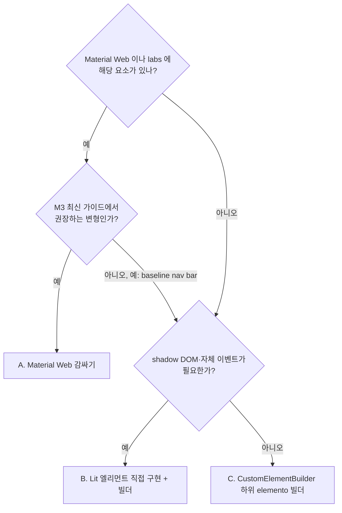

# 3. 컴포넌트 추가

먼저 어느 형태인지 정합니다([01-architecture.md](01-architecture.md) 의 A·B·C).

## 공통 순서

1. 수치를 정합니다. `@material/web` 의 `md-comp-*` 토큰 scss 를 우선 출처로 쓰고, 토큰에 없는 값은 출처를 함께 적어 `[토큰 외]`, 역산한 값은 `[파생]` 으로 표시합니다.
2. 빌더를 만듭니다(아래 형태별).
3. 테스트를 만듭니다([04-testing.md](04-testing.md)): GWT 모듈, 진입점, `*ComponentsTest`, 테스트 페이지, Kotest 스펙.
4. README 의 지원 컴포넌트 표와 사용 예제를 갱신합니다.
5. `./gradlew cleanTest build` 로 전체 테스트가 통과하는지 확인합니다.

## A. Material Web 감싸기

- `dom/` 에 `@JsType(isNative = true, namespace = GLOBAL)` 바인딩을 둡니다(예: `MdButtonElement`). 변형은 `name = "HTMLElement"` 하위 클래스로 둡니다.
- 빌더는 elemento 의 `htmlContainer("md-...", Md...Element.class)` 로 요소를 만들고, `element()`/`that()` 을 구현합니다. 공통 동작은 `interfaces/` 의 특성(`Disableable`, `HasAriaLabel`, `Clickable` …)을 구현해 얻습니다.
- labs 컴포넌트라면 `labs-bundle/src/index.js` 에 import 를 추가합니다. labs/gb 처럼 `.css` 를 import 하는 컴포넌트는 `rollup.config.js` 의 `css-module-to-cssresult` 가 처리합니다.

## B. Lit 엘리먼트 직접 구현

- `labs-bundle/src/sayaya-<영역>.js` 에 `LitElement` 를 만들고 `index.js` 에서 import 합니다.
- 정의는 반드시 `if (!customElements.get(name)) customElements.define(name, Ctor)` 로 합니다.
- 치수·모양은 `var(--md-<컴포넌트>-<부위>, <토큰 기본값>)` 처럼 CSS 변수로 노출합니다. 기본값을 바꾸면 소비자 화면이 바뀌므로 README 에 "동작 변경" 으로 적습니다.
- 생명주기 규칙: `window`·`document` 리스너와 `setTimeout`·`requestAnimationFrame` 은 `disconnectedCallback` 에서 정리하고, 필요하면 `connectedCallback` 에서 다시 시작합니다. `prefers-reduced-motion: reduce` 이면 모션을 생략합니다.
- Java 쪽은 `dom/` 바인딩과 빌더를 만들고, 이벤트는 JS 와 같은 이름으로 `addEventListener` 합니다. `closed` 이벤트의 `detail.reason` 은 `ClosedReason.of(e)` 로 꺼냅니다.
- 단독 번들에 넣을 요소라면 해당 진입점(`sayaya-feedback.js`, `sayaya-navigation-standalone.js`)과 Release 본문(`publish.yaml`)도 함께 갱신합니다.

## C. elemento 빌더(`CustomElementBuilder`)

- `CustomElementBuilder<SELF>` 를 상속하고 `that()` 만 구현합니다. 루트는 `div` 입니다.
- `dom/` 바인딩과 `@JsType` 을 쓰지 않습니다. import 는 elemental2, `org.jboss.elemento`, `jsinterop.base.Js`, `java.util` 로 한정합니다.
- 스타일은 `injectStyle(STYLE_ID, () -> css)` 로 문서에 한 번만 붙입니다.
- 열고 닫는 컴포넌트는 `Openable`, 날짜·숫자 표기는 `HasLocale` 과 `Locales`, UI 문구는 `HasLabels<Label>` + `UiLabel`(영어 기본값)을 구현합니다.
- 폭이 0 인 시점에 배치를 다시 시도해야 하면 `LayoutRetry` 를 씁니다.

## 공개 API 원칙

- 리비전 사이에 공개 타입·메서드 시그니처를 바꾸지 않습니다. 추가만 합니다.
- 이름 변경·상속 계층 변경은 별칭 + `@Deprecated` 를 거쳐 메이저 버전에서 합니다.
- 공통 코드는 패키지 범위 헬퍼나 `protected` 메서드로 묶습니다.
