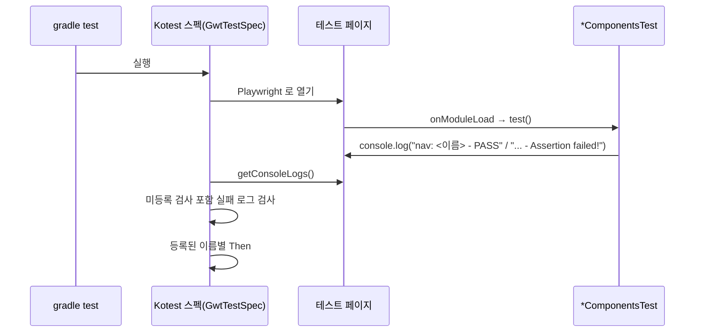

# 4. 테스트

## 구조

컴포넌트마다 다섯 조각이 짝을 이룹니다(예: navigation).

| 조각 | 파일 | 역할 |
|---|---|---|
| GWT 테스트 모듈 | `src/test/java/dev/sayaya/NavigationElementTest.gwt.xml` | `rename-to='navigation'`, `dev.sayaya.Ui` 상속, 진입점 지정 |
| 진입점 | `src/test/java/dev/sayaya/ui/NavigationElementTest.java` | `EntryPoint.onModuleLoad()` 에서 `NavigationComponentsTest.test()` 호출 |
| 검사·데모 | `src/test/java/dev/sayaya/ui/navigation/NavigationComponentsTest.java` | 컴포넌트를 만들고 `assertTrue`/`assertEquals` 로 검사, 데모 섹션 생성 |
| 테스트 페이지 | `src/test/webapp/navigation.html` | all.js → `labs.bundle.js` → `navigation/navigation.nocache.js` 순서로 로드 |
| Kotest 스펙 | `src/test/kotlin/dev/sayaya/ui/test/NavigationElementTest.kt` | `@GwtHtml("navigation.html")`, Playwright 로 페이지를 열고 콘솔 로그를 JUnit 결과로 변환 |



테스트 페이지는 GitHub Pages 데모로도 배포됩니다(`deploy-test-webapp.yml`). 그래서 `*ComponentsTest` 는 데모 설명(`demo`, `section`)도 함께 만듭니다. 사람이 볼 때 자동 클릭·스크롤을 하지 않도록 `isAutomated()` 로 막습니다.

## 작성 규칙

- 검사 메시지는 `<접두어>: <검사 이름>` 형식으로 쓰고(`nav:`, `fb:` …), 같은 이름을 Kotest 스펙의 이름 목록에 등록합니다. 이름에 측정값처럼 바뀌는 문자열을 넣지 않습니다.
- 등록을 빠뜨려도 실패는 잡힙니다. 모든 스펙 첫머리의 `실패한 검사 로그가 없어야 한다(미등록 검사 포함)` 가 모든 로그에서 `Assertion failed!` 를 찾습니다. 다만 결과 목록에 이름이 보이도록 등록은 계속 합니다.
- 공용 헬퍼는 `TestHelper` 를 씁니다: `cs(e)`, `cs(e, pseudo)`, `shadow(host)`, `inner(host, sel)`, `q(root, sel)`, `later(ms, r)`, `isAutomated()`, `section`, `demo`. 테스트 클래스에 복사본을 만들지 않습니다.
- 치수 검사는 `getComputedStyle`·`getBoundingClientRect` 로 실제 값을 봅니다. 부동소수 비교는 허용 오차를 둡니다.
- 모션을 넣은 컴포넌트는 전환 중 중간값과 전환 후 최종값, 인라인 스타일 정리를 모두 검사합니다.

## 실행

```bash
./gradlew test                                                # 전체
./gradlew test --tests 'dev.sayaya.ui.test.NavigationElementTest'   # 한 스위트
./gradlew cleanTest test --tests '...'                        # 강제 재실행
```

- `:test` 는 테스트 페이지가 싣는 번들(`src/test/webapp/labs.bundle.js`, `sayaya-ui-feedback.js`, `sayaya-ui-navigation.js`, 모두 복사 태스크가 만드는 산출물)을 입력으로 봅니다. JS 만 바꿔도 다시 실행됩니다.
- 처음 실행하면 Playwright 브라우저를 내려받으므로 오래 걸립니다.
- 결과는 `build/test-results/test/TEST-*.xml` 에 있고, `system-out` 에 콘솔 로그가 남습니다.

## 변조 검증

테스트가 결함을 실제로 잡는지 확인하는 절차입니다.

1. 버그 수정: 고치기 전 코드로 새 검사를 돌려 **실패**를 먼저 봅니다. 고친 뒤 통과를 봅니다.
2. 리팩토링·새 기능: 고친 지점을 일부러 망가뜨려(예: CSS 규칙 선택자 바꾸기, 헬퍼가 null 반환) **그 지점에 의존하는 검사만** 실패하는지 봅니다.
3. 원래대로 되돌리고 `cmp` 나 `git diff` 로 원본과 같은지 확인합니다.
4. JS 를 변조했다면 `cleanTest` 를 붙이거나 테스트 번들이 다시 복사됐는지 확인합니다.
