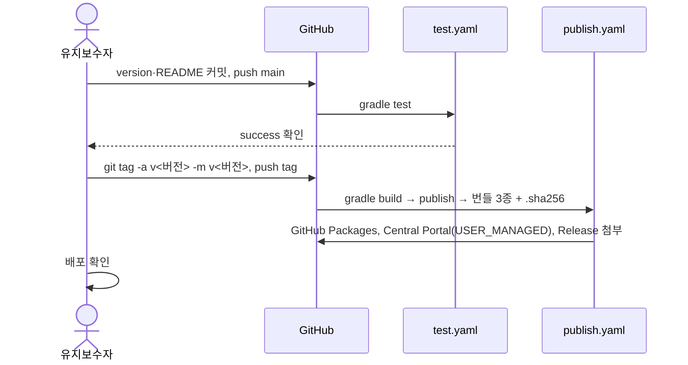

# 5. 릴리스

## 버전 규칙

`<Material Web 버전>.<리비전>` 입니다(예: `2.5.0.8`). Material Web 버전이 같으면 리비전만 올립니다. 버전은 `build.gradle.kts` 의 `version` 이 기준이고, README 설치 좌표(`implementation("dev.sayaya:ui:<버전>")`)와 새 기능 표기(`(2.5.0.N~)`, "동작 변경(2.5.0.N부터)")를 같이 맞춥니다.

## 절차

1. `build.gradle.kts` 의 `version` 과 README 를 고쳐 커밋하고 main 을 push 합니다.
2. 그 커밋의 `테스트` 워크플로가 success 인지 확인합니다(`gh run list --branch main`).
3. 이전 태그와 같은 **annotated** 태그를 만들어 push 합니다: `git tag -a v2.5.0.N -m v2.5.0.N <커밋>`, `git push origin v2.5.0.N`.
4. `Publish` 워크플로가 success 인지 확인합니다.

## 배포 확인

| 항목 | 확인 방법 |
|---|---|
| Release | `gh release view v<버전>`: draft=false, Latest, 첨부 9개(jar·sources·javadoc, `sayaya-ui-<v>.js`, `sayaya-ui-feedback-<v>.js`, `sayaya-ui-navigation-<v>.js`, 각 `.sha256`) |
| 번들 무결성 | 첨부를 받아 `shasum -a 256 -c` |
| GitHub Packages | 최신 버전이 새 버전인지 |
| jar 내용 | 받은 jar 의 클래스를 `javap` 로 열어 새 메서드 시그니처 확인 |
| 번들 내용 | 새 속성·문자열을 `grep` 으로 셈 |
| Maven Central | `https://repo1.maven.org/maven2/dev/sayaya/ui/<v>/ui-<v>.pom` 이 200 인지 |

Maven Central 주의: Publish 로그의 `Uploaded bundle to Central Portal as USER_MANAGED, deployment id: …` 처럼 USER_MANAGED 로 올라가므로, central.sonatype.com 의 Deployments 에서 직접 Publish 해야 repo1 에 공개됩니다. 공개 후 반영까지 수십 분이 걸릴 수 있습니다. `maven-metadata.xml` 의 latest 는 늦게 갱신되므로 판단 근거로 쓰지 않습니다.

## 같은 버전을 다시 배포할 때

1. GitHub Packages 에 그 버전이 남아 있는지 다시 조회하고, 있으면 지웁니다(남아 있으면 Publish 가 409 로 실패).
2. Maven Central 은 같은 버전을 덮어쓸 수 없습니다. 이미 공개됐으면 리비전을 올립니다.
3. 기존 Release 를 지우고, 태그를 새 커밋을 가리키는 annotated 태그로 다시 만들어 push 합니다.
4. 소비자에게 `--refresh-dependencies` 와 JS 캐시 비우기를 안내합니다(첨부 URL 은 같고 내용만 바뀜).

## 산출물에 대해

- jar 에는 JS 가 없습니다. JS 는 Release 첨부물로만 배포됩니다.
- Material Web 을 따로 싣는 앱에 단일 번들을 함께 실으면 `md-*` 이름이 두 번 정의되어 `NotSupportedError` 가 납니다. 그런 앱에는 feedback·navigation 번들을 안내합니다.
